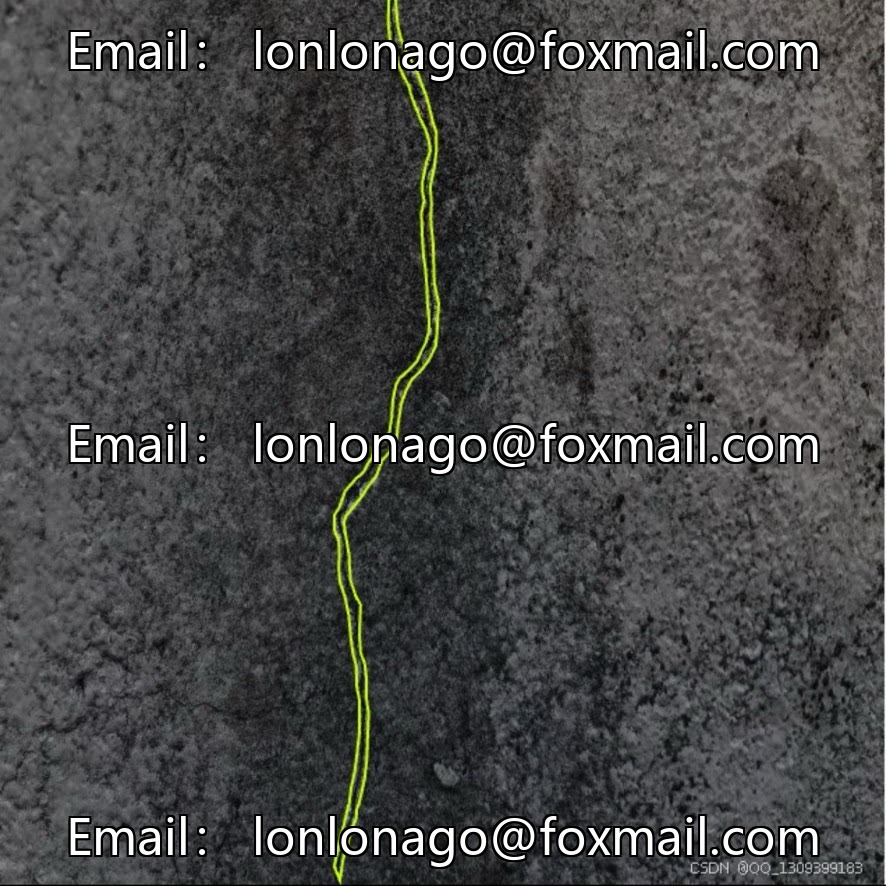
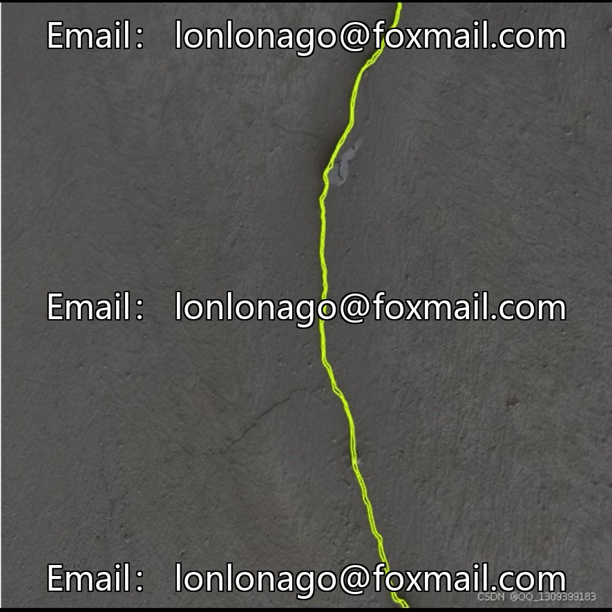
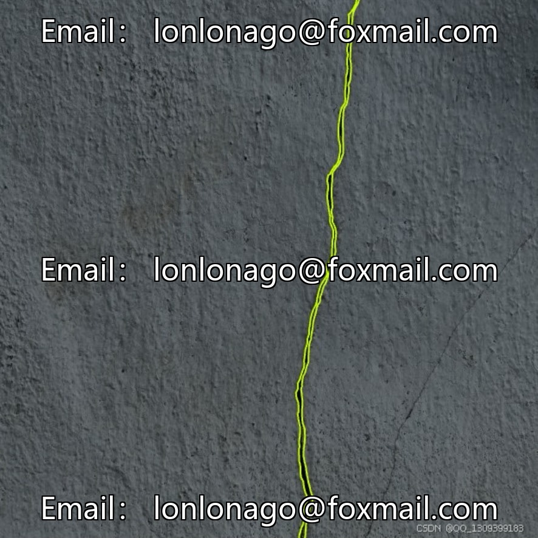
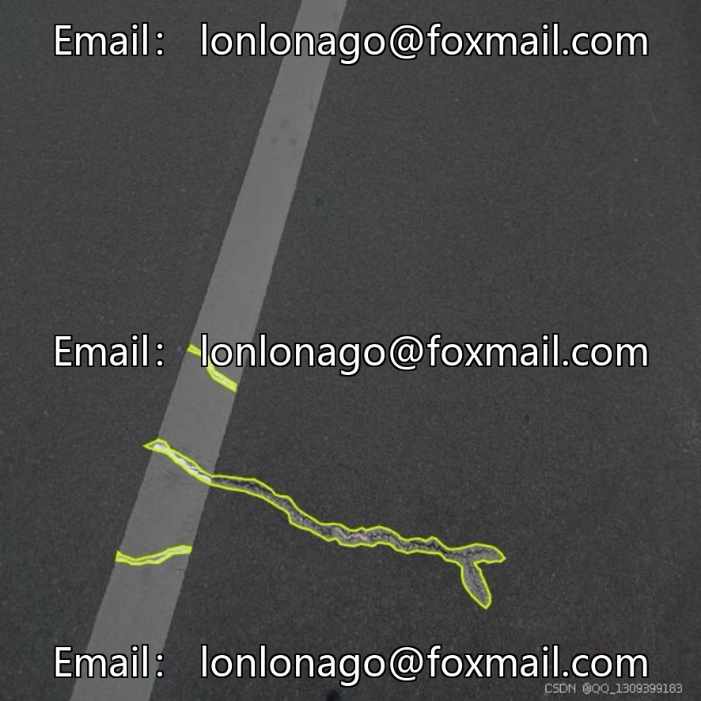
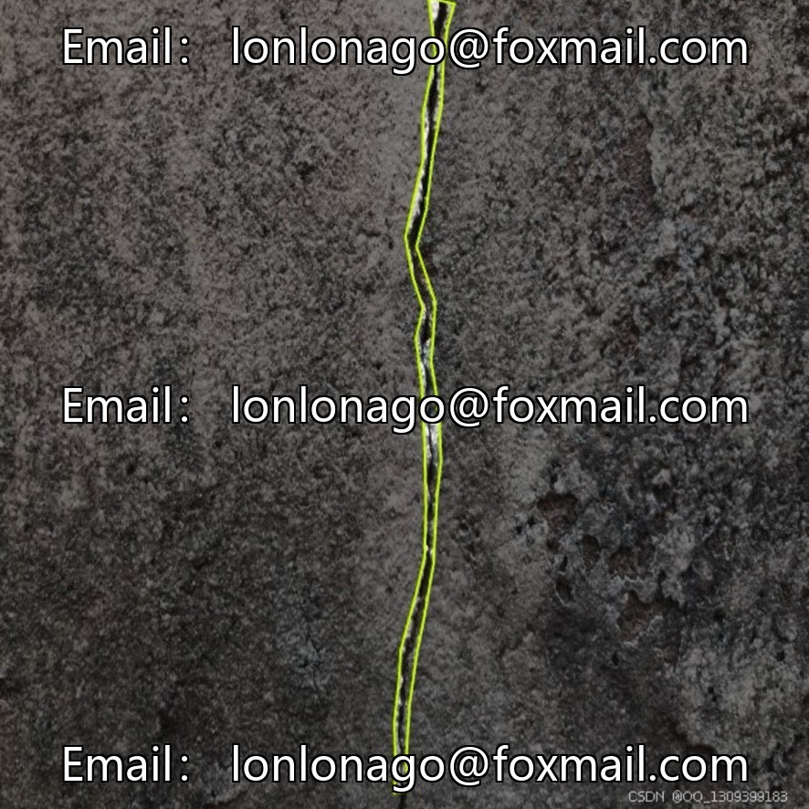
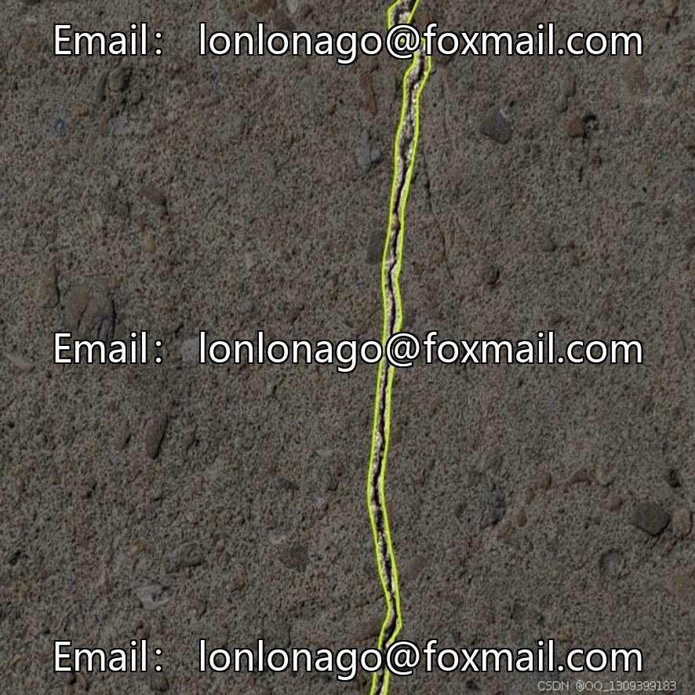

# UAV aerial photography crack image segmentation dataset (walls, roads, bridges)

## Body

UAV aerial photography crack image segmentation dataset (walls, roads, bridges)
Project number: 10052th issue

The dataset consists of 1,272 professional-annotated images, focusing on the recognition of crack target contours, suitable for structural health monitoring scenarios in buildings, transportation, industry, etc.
Core category: Crack (Crack), with concise and focused annotations, enhancing the model's ability to learn features of cracks.

Task Type: Instance segmentation
Total Images: 1,272
Number of Categories: 1
Annotation Format: Instance segmentation labels (specific format requires referencing the source file)
Data Partitioning: Not explicitly announced; it is recommended to partition training/validation/test sets as 7:1.5:1.5 or 8:1:1

Recommend using high-resolution images (such as 1024×768, 1280×720), which can be adjusted according to the model input requirements.

Virtual materials, once sold, are non-refundable.
Interested friends, click "I want" to proceed.

## Images

## Payment

Here is a pay link on Stripe ( https://buy.stripe.com/3cs8yP7sY87d0vu9AB ). Please contact me lonlonago@foxmail.com after funding $89, and I will send you a complete data files , thank you!

